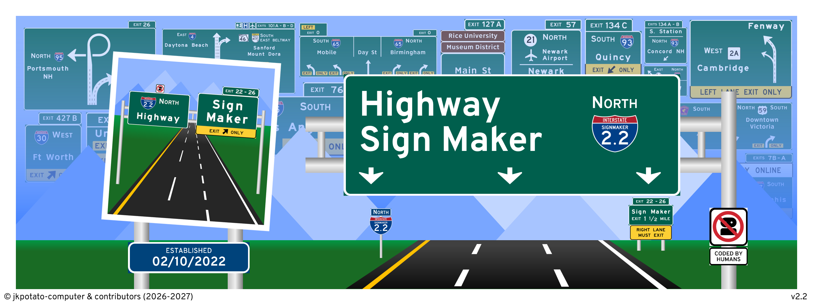

#  Highway SignMaker
Version: 2.2_indev

SignMaker is a JavaScript-based web application designed to render realistic highway guide signage for all states and any MUTCD-adjacent countries. 

**History**

First envisioned by [Kurumi](https://www.kurumi.com/) in creating [SignMaker v2.3.1](https://www.kurumi.com/roads/signmaker/signmaker.html), SignMaker started off as a Java Applet (back when it was supported within web browsers!) and was quite revolutionary for its era, winning Yahoo's "Pick of the Week" in April 1998.[1](https://www.kurumi.com/roads/signmaker/index.html) In late 2019, [BrenStro](https://github.com/BrenStro/SignMaker) would create the first port of SignMaker, aiming to recreate most of Kurumi's features in a modern web browser context. This would be further expanded by [dki-os](https://github.com/dki-os/SignMaker) with the addition of Quebec Exit Tabs, Action/Advisory Messages, a couple extra shields, and additonal Exit Tabs. 

This version of SignMaker aims to continue modernizing Highway Sign Maker with additional graphic features that align to the current version of the [Manual on Uniform Traffic Control Devices (MUTCD)](https://mutcd.fhwa.dot.gov/pdfs/11th_Edition/mutcd11thedition.pdf). What are they, you may ask? Here's a small collection of items:

## Features

SignMaker features a dedicated block-based editor system compared to being limited to a single Control Text and/or Action Message, allowing you to create virtually any sign combination imaginable. There are over 11 different elements to choose from, all with their own unique settings and configurations. Oh yeah, these are draggable too.

 

It's best if you discover this yourself rather than me telling you each of these items individually. :)

2. Shield Editor System
3. Guide Arrows / APL / Diagrammic
4. Exit Tabs
5. SubPanel System
6. Saving / Loading / Exporting / Templates

## Contributing TBD
Thank you to the following contributors for helping out with the developemnt of SignMaker v2.2:
- @vivribbon: Redoing pretty much every single shield in `shield.css`, NVUTCDG Guidelines
- @theobsidianguy: 

## Sources Used TBD

(c) BrenStro 2020.
(c) dki-os 2024.
(c) JK_Potato/Computer and contributors 2026.

Licensed under the [GNU License](https://www.gnu.org/licenses/gpl-3.0.txt), see [LICENSE](LICENSE) for details.
