# 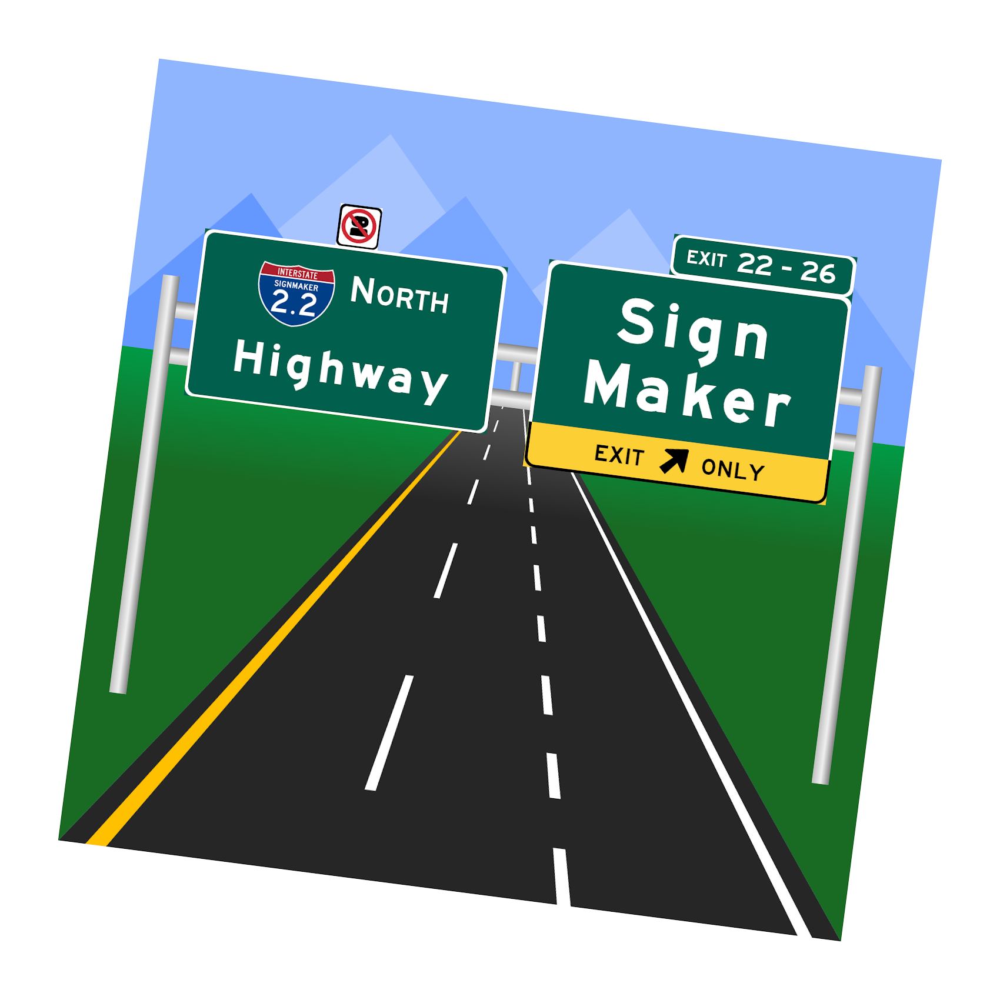 Highway SignMaker

Version: 2.2_prerel

SignMaker is a JavaScript-based web application designed to render realistic highway guide signage for all states in the United States, neighboring countries, and any MUTCD-adjacent countries. Try out the website LIVE at [https://jkpotato.computer/SignMaker]()!

#### History

First envisioned by [Kurumi](https://www.kurumi.com/) in creating [SignMaker v2.3.1](https://www.kurumi.com/roads/signmaker/signmaker.html), SignMaker started off as a Java Applet (back when it was supported within web browsers!) and was quite revolutionary for its era, winning Yahoo's "Pick of the Week" in April 1998.<sup>[source](https://www.kurumi.com/roads/signmaker/index.html)</sup> In late 2019, [BrenStro](https://github.com/BrenStro/SignMaker) would create the first port of SignMaker, aiming to recreate most of Kurumi's features in a modern web browser context. This would be further expanded by [dki-os](https://github.com/dki-os/SignMaker) with the addition of Quebec Exit Tabs, Action/Advisory Messages, and a couple extra shields.

This version of SignMaker aims to continue modernizing Highway Sign Maker with additional graphic features that align to the current version of the [Manual on Uniform Traffic Control Devices (MUTCD)](https://mutcd.fhwa.dot.gov/pdfs/11th_Edition/mutcd11thedition.pdf) while keeping it (relatively) simple to use as possible. Default values and configurations for signs were decided based off best-guess estimates found from the [Standard Highway Signs](https://mutcd.fhwa.dot.gov/kno-shs_2024.htm) publication, but at least you change it to your own desires.

> Note: There is no tutorial for SignMaker (except the Diagrammatic Editor). The best way to discover how this site works is not by me telling you what to try out, but rather throwing yourself in the wild and seeing how to use SignMaker. I mean, that's how you learn how to use OpenRoads SignCAD or other CAD software, right?

## Features

These are all the main features of SignMaker v2.2, but this isn't an exhaustive list. Like I said, the best way to learn how to use SignMaker is to just throw yourself in and see what you can do with it. Without further ado...


### 1. Block Element System

SignMaker features a dedicated block-based editor system compared to being limited to a single Control Text and/or Action Message, allowing you to create virtually any sign combination imaginable. There are over 11 different elements to choose from, all with their own unique settings and configurations. Some notable ones include:

|      Block Element       |                                                            Description                                                             |
| :----------------------: | :--------------------------------------------------------------------------------------------------------------------------------: |
|   Control Text Element   |         The main text of the sign, primarily to list destinations (it's the most basic out of all the text-based elements)         |
|  Action Message Element  |               The supplemental text of the sign, primarily to list upcoming mileage-based exits (ex: EXIT 1/2 MILE)                |
| Advisory Message Element |                            The supplemental text of the sign, now with a background! (ex: EXIT 35 MPH)                             |
| Electronic Sign Element  | The supplemental text of the sign in a "digitized-like" format, typically used with variable/changing messages (ex: express lanes) |
|           Icon           |                             A graphic element, with additional support of custom icons (ex: airplane)                              |
|       Shield Group       |                           A group of shields with support of banners and custom shields (ex: US 90 ALT)                            |

and more...

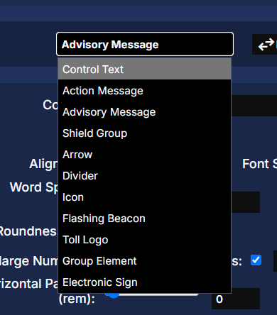

Block rows themselves can also be edited, allowing you to change the background color, posiitoning, and the "spacing" from other elements.

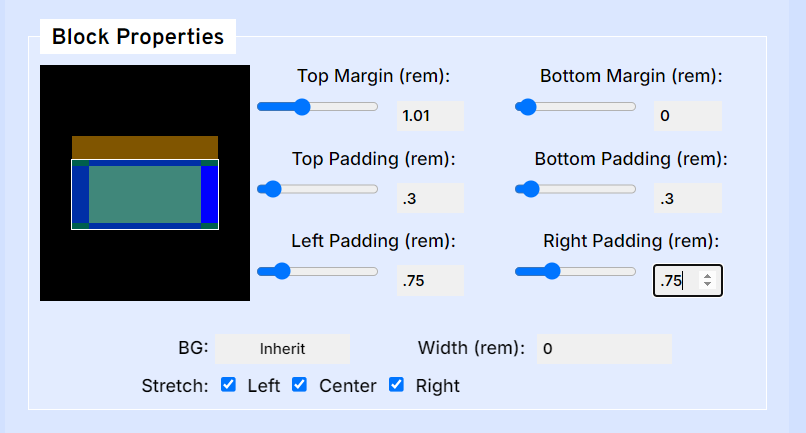

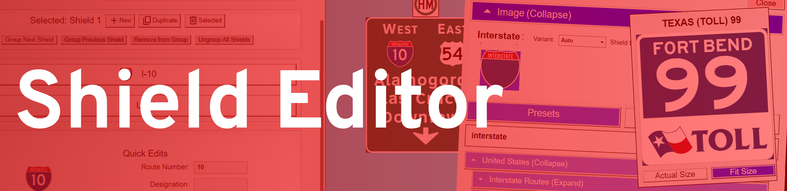

### 2. Shield Editor System

Gone with the inline shield & banner editor system of the Kurumi/dki-os era (though it was very intuitive, so I'll give them that), SignMaker v2.2 features a dedicated shield editor system that allows you to create and edit shields in a more intuitive way. You can also add as many banners as you want, in all directions, and even customize the built-in shields and create entirely custom ones.

TIP: Want NORTH / NORD signage like the ones in Ontario? Type in NORTH/nNORD in the banner text field!

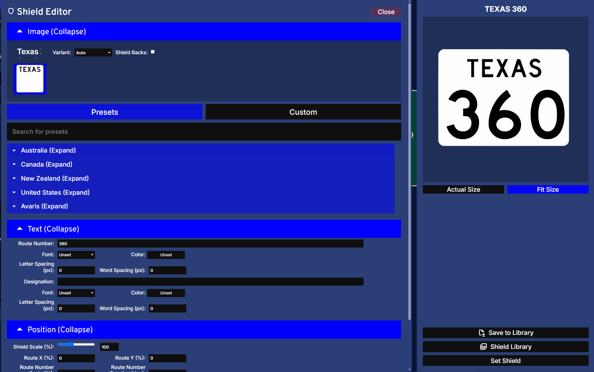

(Custom Shields)
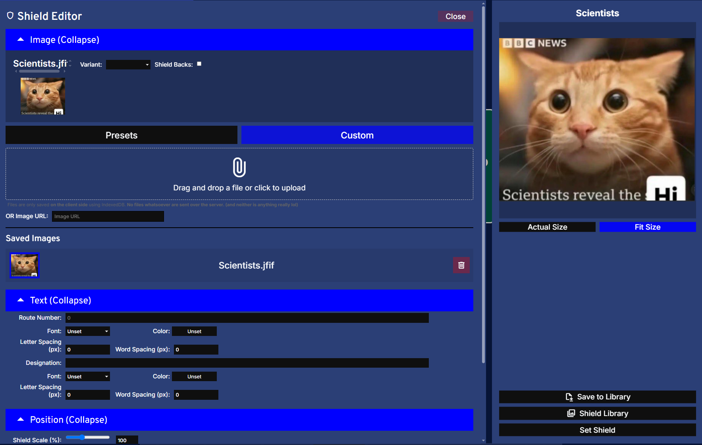

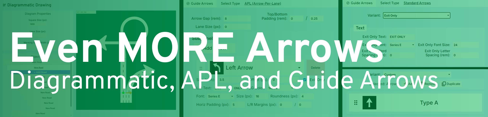

### 3. Guide Arrows / APL / Diagrammatic

A feature that EVERYONE has been anticipating for has finally come, this time with THREE different variants.

#### Guide Arrows

The guide arrows system has been refreshed completely with countless more customizable features (while still remaining relatively simple to use). You can now have different guide arrows on a single sign rather than just one of some type, additional exit only border variants, and the ability to add an additional action message / Quebec exit tabs (which was from dki-os, but now fixed to work with this SignMaker version!)

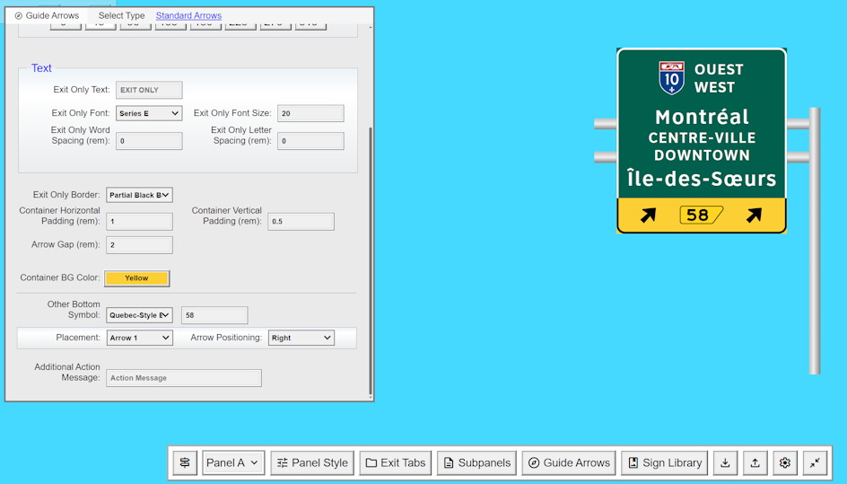

### Arrow Per Lane (APL)

The arrow per lane (APL) system has finally been released, allowing you to draw an arrow... per lane. Pretty self explanatory, works well with subpanels.

TIP: Use Lane Size to make signs somewhat "realistic" in size based off how many arrows were "assigned" to that region.

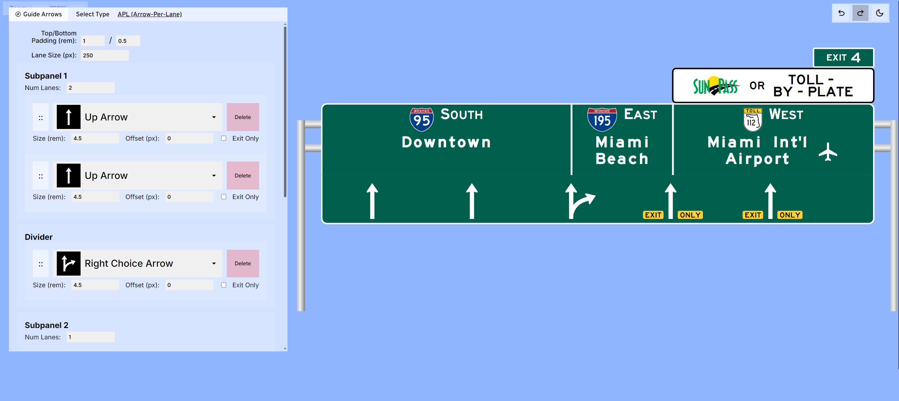

### Diagrammatic Signage

Diagrammatic signage, something once thought to be possible, is officially in SignMaker v2.2 with a relatively easy interface to work with. It'll be a learning curve, but once you figure it out, it is quite intuitive.

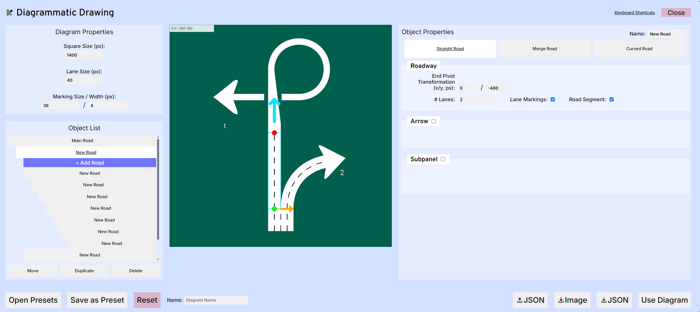

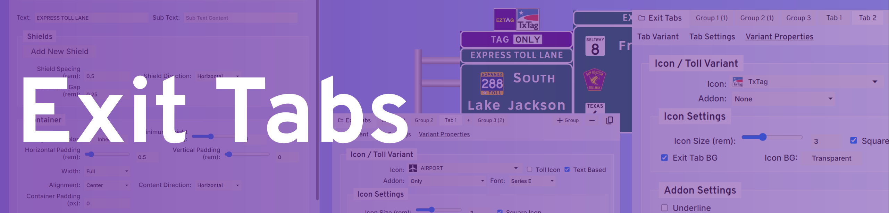

### 4. Exit Tabs

The exit tab system has been completely reworked this update (from the backend to the frontend) with SIX standardized variants to play with! Maybe the image will speak for itself... this picture does speak 42 words after all. Did you know that you can put shields on exit tabs now?

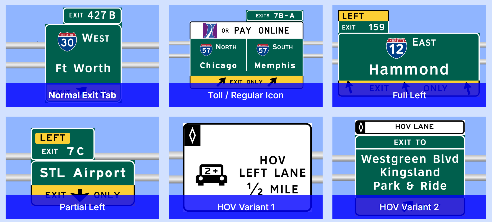

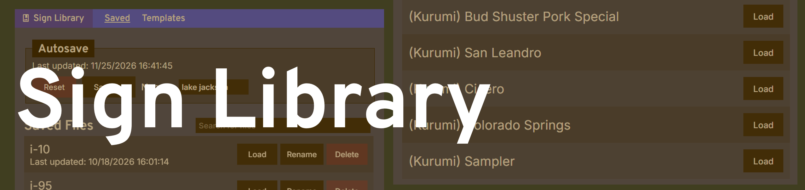

### 5. Sign Library

No longer do you have to restart everything when your page refreshes or you are done with the project. With the new Sign Library system, your signs now auto-save across sessions and can be reloaded at any time. Additionally, you can have multiple "save files" of all the signs that you have made and load them in at any time.

There's also a few templates, more will be made soon. For nostalgic purposes, here's the header page of the "Del Water Gap" sign on the dki-os/SignMaker README, which is now a template in SignMaker v2.2.
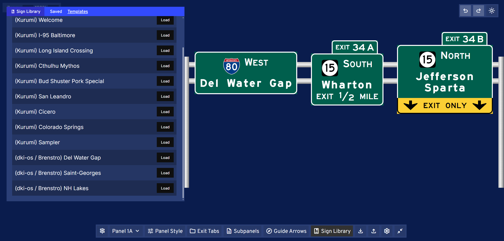

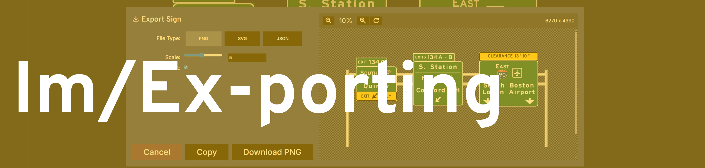

### 6. Importing & Exporting

Last but not least, what's SignMaker without being able to export your signs? You can now export high-quality signs in PNG and SVG format. Additionally, you can share your signs in .SIGNMAKER (defiintely not .JSON) format with your friends, and they can share you signs to import into SignMaker v2.2! Talk about going full circle.

Only compatible with SignMaker v2.2 signs.

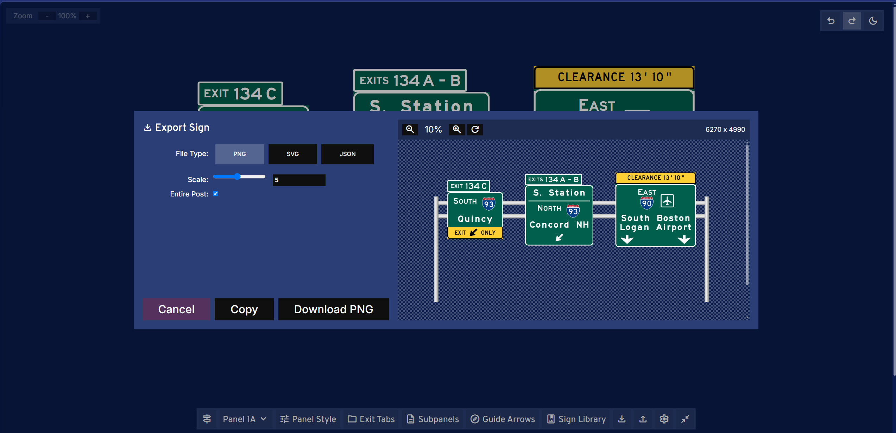

## Setup

SignMaker v2.2 can run entirely locally - there is NO webserver needed for SignMaker to function. (github-like instructions here)

### 1. Clone the repository from GitHub

```bash
git clone https://github.com/JKPotato-Computer/SignMaker
cd SignMaker
```

### 2. Run the project

**Option A:** Open the `index.html` file in your web browser. (This will not support exporting images.)

**Option B:** If you have [Node.js](https://nodejs.org) installed, you can start a local web server for SignMaker. This program uses Vite to start the development server; however, Python (`py -m http.server`) also sufficies. Run the following commands in the project directory:
(npm install, create a vite.config.js file too with vite terminal)

```bash
npm install
# Ensure that you have vite.config.js installed and configured + node modules, then:
npx vite
```

## SignMaker Pull Request Policy

(As follows in the Discord Server): Earlier variants of SignMaker were built WITHOUT the use of AI, and we will continue to honor these directions in the creation of the Official SignMaker project as best as possible. **The Official SignMaker has not been mass-generated or piloted with the use of AI**, and all code implementations/features have been meticulously designed by a human person.

- **AUTHENTICITY:** All submitted pull requests must NOT be entirely AI-generated / "vibecoded". While this ruling is entirely subjective, the baseline is: your code may be AI-assisted and written with the help of AI; however, AI should not have taken full lead of your code submission. A project maintainer should be able to read your code without any complications given a reasonable amount of time.
- **LENGTH:** Pull requests should generally focus on 1-3 features and not attempt to restructure entire codebases to implement features. IF the latter case is proven to be necessary, your code will REALLY be reviewed in detail before any approval is made.
- **DESCRIPTION:** ALL changes MUST be highlighted directly on the pull request on GitHub, NOT in a Discord message unless given permission to do so. Both would be preferable, but the former is required.

Enforcement Policy: If your PR does not follow these guidelines, it will NOT be accepted.

## Contributors

Thank you to the following contributors for helping out with the developemnt of SignMaker v2.2:

- @vivribbon: Redoing pretty much every single shield in `shield.css`, Double-Stroke Borders, NVUTCDG Guidelines :P
- @theobsidianguy: Fixing the APL system, inverting arrow colors, and general UI/UX
- @cjc30: Australian shields

And a massive thank you to the past maintainers [@dki_os](http://github.com/dki-os) and [@BrenStro](https://github.com/Brenstro) for even creating Highway Sign Maker in the first place. Hope this version of SignMaker can live up to your expectations and continue to improve upon your work, and maybe a little bit of nostalgia.

## Third-Party Sources

**Font Faces**

- Overpass / Inter typeface was sourced from [Google Fonts](https://fonts.google.com/specimen/Overpass) and is licensed under the [SIL Open Font License 1.1](https://scripts.sil.org/cms/scripts/page.php?site_id=nrsi&id=OFL).
- Clearview typeface was sourced from [Cofonts](https://cofonts.com/clearview-font/).
- FHWA Series typeface was sourced from [Font Space](https://www.fontspace.com/highway-gothic-family-font-f151742) by Barry Stock and is public domain.
- Transport typeface (and its variants) was sourced from [roads.org.uk](https://www.roads.org.uk/fonts).
- Electronic Highway Sign tyepface was sourced from [Dafont](https://www.dafont.com/electronic-highway-sign.font) by Ash Pikachu.
- LLM typeface was sourced from [LEMBAGA LEBUHRAYA MALAYSIA](https://www.llm.gov.my/publication/lettering)
- Engschrift / Mittelschrift was sourced from the Roadgeek 2005 font-face by [Micheal Adams](https://n1en.org/roadgeek-fonts/).
- VCR Mono was sourced from [Dafont](https://www.dafont.com/vcr-osd-mono.font).

**Images**

- All SignMaker v2.2 assets were hand-made by @JKPotato-Computer.
- All UI icons were sourced from Google's [Material Symbols](https://fonts.google.com/icons) and are licensed under the [SIL Open Font License 1.1](https://scripts.sil.org/cms/scripts/page.php?site_id=nrsi&id=OFL).
- Other assets (icons, shields, etc.) were sourced from the [MUTCD](https://mutcd.fhwa.dot.gov/pdfs/11th_Edition/mutcd11thedition.pdf) and other state DOTs.
- Some sign SVG assets were obtained from [Wikimedia Commons](https://commons.wikimedia.org/wiki/Main_Page), with designs originating from the MUTCD.

**Modules**

- [snapdom.dev](https://snapdom.dev/) to capture PNG/SVG images of the sign for exporting, licensed under the [MIT License](https://opensource.org/license/mit)
- [marked.js](https://marked.js.org/) for Markdown parsing, licensed under the [MIT License](https://opensource.org/license/mit)

## SignMaker Usage Disclaimer

**DO NOT USE SIGNMAKER FOR ACTUAL SIGN-MAKING PURPOSES.** SignMaker is a tool for hobbyists and roadgeeks obsessed with the Interstate Highway System and does not comply with real-world measurements, MUTCD standards, and general regulations. SignMaker is not a replacement for professional CAD software and should not be used for any real-world sign-making purposes. Besides, if this statement applies to you, you're probably a State Transportation department, you definitely have enough money to afford CAD software. (Maybe from all the toll-revenue you've been collecting, talking to YOU Texas.)

Signs made with the FHWA font face, Overpass, Electronic Highway Sign, VCR Mono (I think?), and/or LLM is under public domain and can be displayed on sites or used for commercial purposes. Signs made with the Transport or Clearview font technically are only allowed for personal use, but I can't really tell you what you can and can't do with them. So, I will pretend that I didn't see anything. :)

(c) BrenStro 2020.
(c) dki-os 2024.
(c) JK_Potato/Computer and contributors 2026-2027.

Licensed under the [GNU General Public License v3.0](https://www.gnu.org/licenses/gpl-3.0.txt), see [LICENSE](LICENSE) for details.
