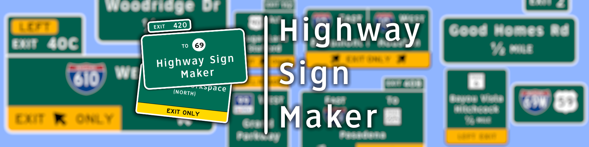

#  Highway SignMaker
Version: 2.2_indev

SignMaker is a JavaScript-based web application designed to render realistic highway guide signage. First envisioned by [Kurumi](https://www.kurumi.com/) in creating [SignMaker v2.3.1](https://www.kurumi.com/roads/signmaker/signmaker.html) before being ported to a website by [BrenStro](https://github.com/BrenStro/SignMaker) and expanded by [dki-os](https://github.com/dki-os/SignMaker), this fork aims to further modernize Highway Sign Maker with additional graphic and visual features.

## Sections TBD
1. Block Eleemnts
2. Shield Editor System
3. Guide Arrows / APL / Diagrammic
4. Exit Tabs
5. SubPanel System
6. Saving / Loading / Exporting

## Contributing TBD

## Sources Used TBD

(c) BrenStro 2020.
(c) dki-os 2024.
(c) JK_Potato/Computer and contributors 2026.

Licensed under the [GNU License](https://www.gnu.org/licenses/gpl-3.0.txt), see [LICENSE](LICENSE) for details.
